# DXCLINIC — REVISION 40 — FULL SYSTEM WORKFLOWS AUDIT

> Generated: 2026-09-29 | Method: Codebase & Database Transaction Analysis  
> Scope: Complete End-to-End Operational and Clinical Workflows

---

## 1. Clinic Provisioning, Onboarding & Activation Workflow

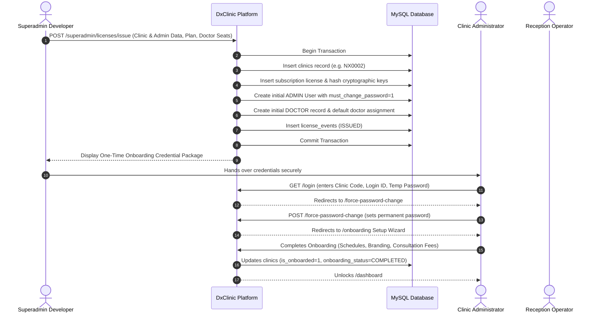

---

## 2. License Renewal & Doctor Seat Add-On Workflow

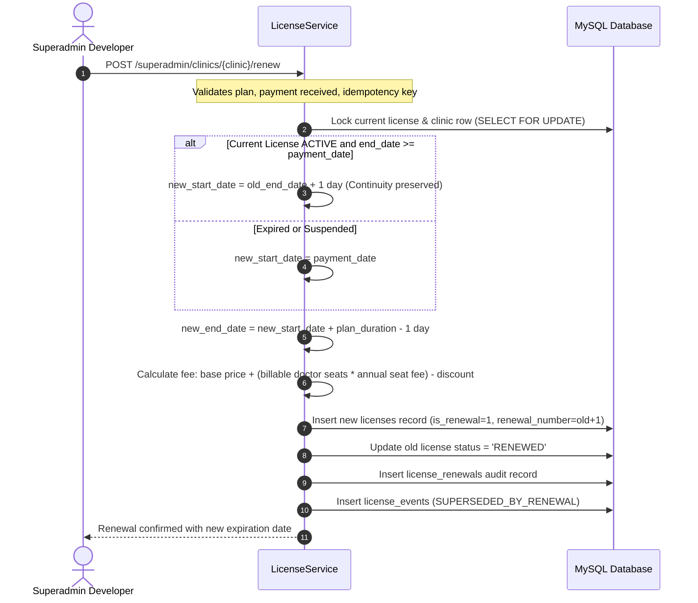

---

## 3. Patient Appointment & Queue Management Workflow

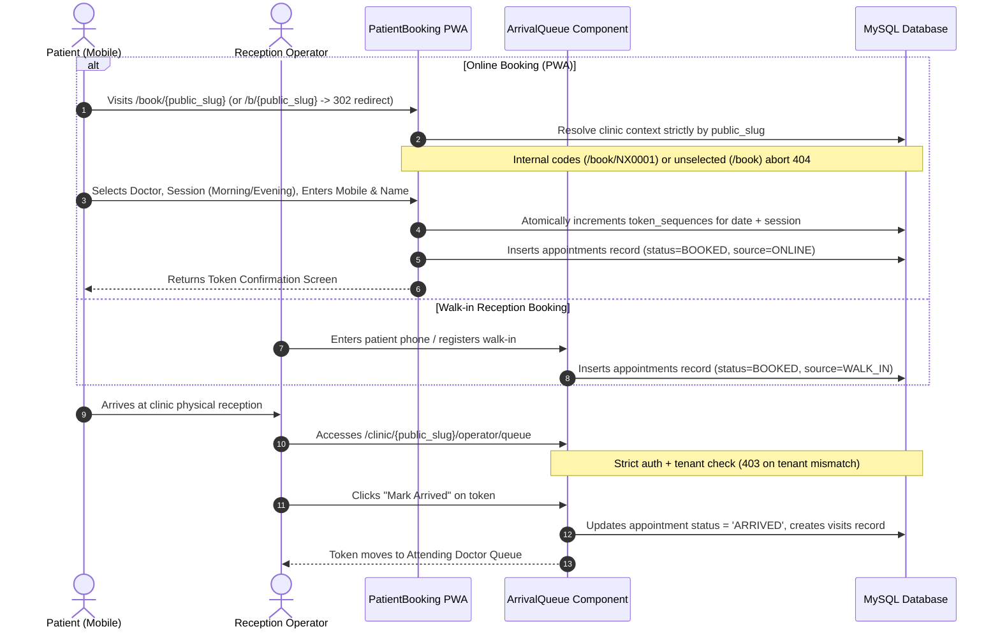

---

## 4. OPD Clinical Consultation & Prescription Generation Workflow

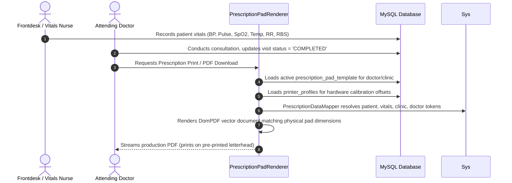

---

## 5. Diagnostic Billing & Investigation Workflow

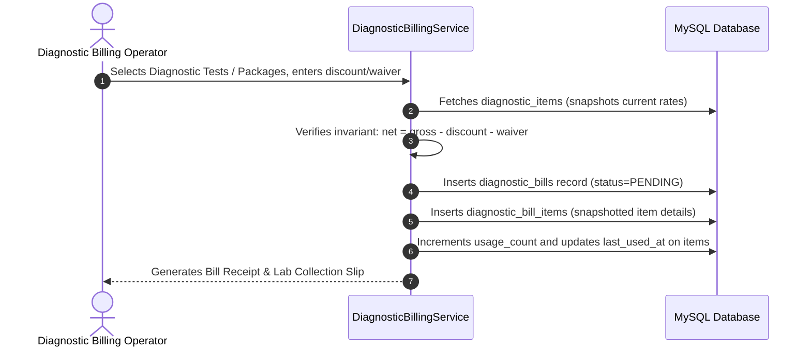

---

## 6. Cash Drawer Session & Shift Reconciliation Workflow

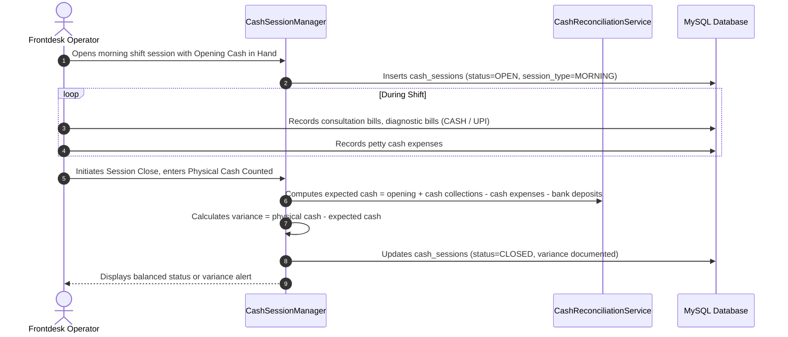

---

## 7. Hard-Drive Local Backup & Restore Workflow

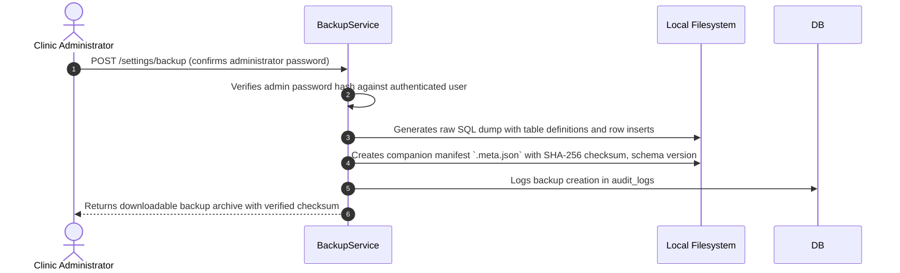

---

## 8. Platform Commercial Sales, Invoicing & Reconciliation Workflow (Revision 42)

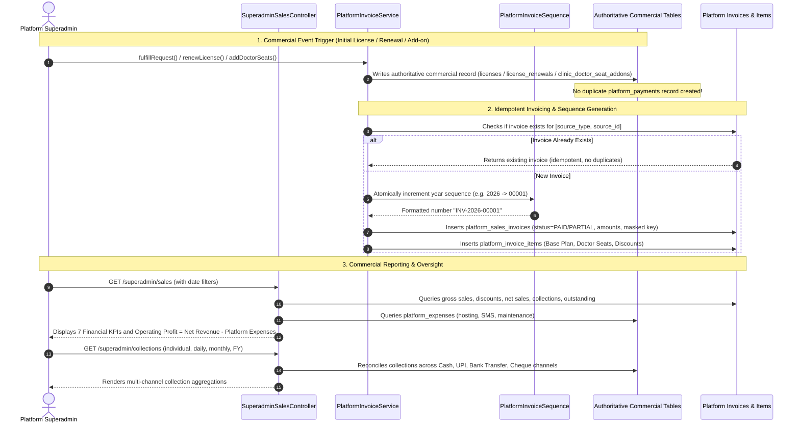

---

## 9. Doctor + Booking Type + Fee Master Configuration Workflow (Revision 45)

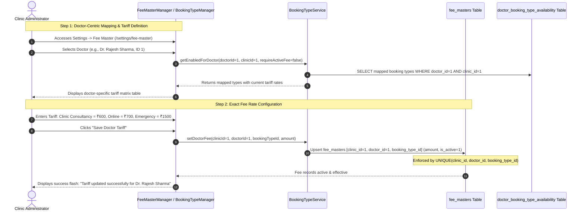

---

## 10. Unified Consultation Booking & Fee Resolution Workflow (Revision 45)

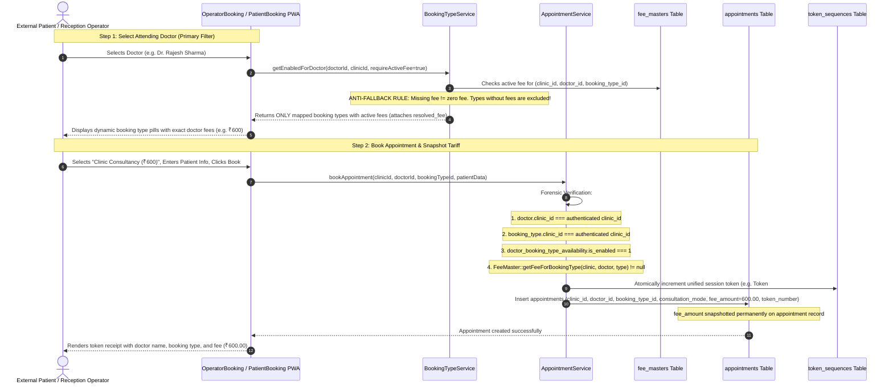

---

## 11. Conceptual Demarcation: The Four Independent Booking Dimensions

Revision 45 enforces strict separation of four orthogonal operational concepts:

```
+---------------------------------------------------------------------------------------------------+
| 1. BOOKING SOURCE                                                                                 |
| Where the booking originated.                                                                     |
| Values: 'CLINIC' (Walk-in Desk), 'ONLINE' (Patient PWA), 'TELEPHONIC' (Phone Inbound)              |
+---------------------------------------------------------------------------------------------------+
                                                  |
                                                  v
+---------------------------------------------------------------------------------------------------+
| 2. CONSULTATION MODE                                                                              |
| How the consultation/service is delivered to the patient.                                         |
| Values: 'CLINIC_PHYSICAL' (In-person), 'ONLINE' (Video/Tele-consult), 'VISITING_CONSULTANCY'       |
+---------------------------------------------------------------------------------------------------+
                                                  |
                                                  v
+---------------------------------------------------------------------------------------------------+
| 3. BOOKING TYPE                                                                                   |
| What clinical or service package the patient is booking.                                         |
| Values: 'CLINIC_CONSULTANCY', 'ONLINE_CONSULTANCY', 'EMERGENCY_CONSULTANCY', or Custom Clinic Type |
| Tenant Ownership: Exactly one clinic (booking_types.clinic_id).                                   |
+---------------------------------------------------------------------------------------------------+
                                                  |
                                                  v
+---------------------------------------------------------------------------------------------------+
| 4. DOCTOR TARIFF / FEE MAPPING                                                                    |
| Financial rate explicitly configured for (clinic_id + doctor_id + booking_type_id + effective_from)|
| Authoritative Lookup: FeeMaster::getFeeForBookingType($clinicId, $doctorId, $bookingTypeId, $date)|
| Anti-Fallback Guard: If unconfigured, booking is BLOCKED. Explicit ₹0.00 allowed; missing != 0.00 |
+---------------------------------------------------------------------------------------------------+
```

---

## 12. Revision 46: Database-Level Enforced Atomic Booking Transaction Workflow

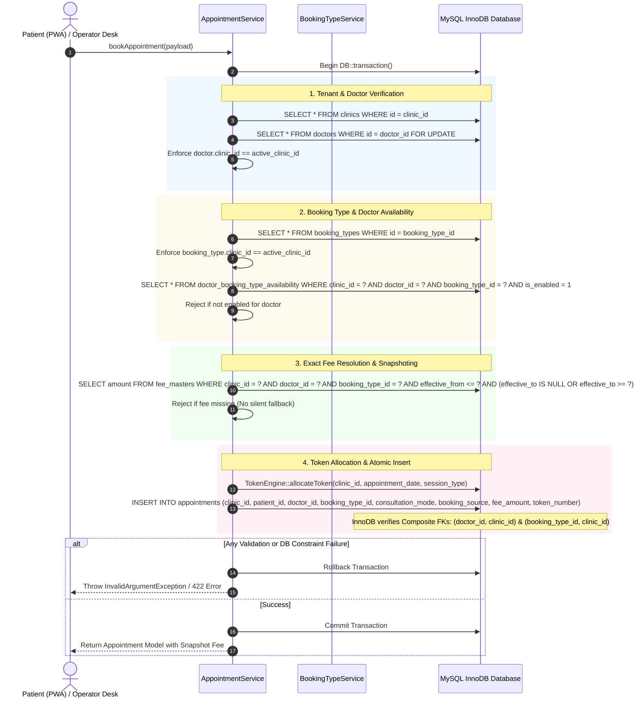

---

## 12. Revision 47: Public Slug Resolution & Tenant Routing Security Workflow

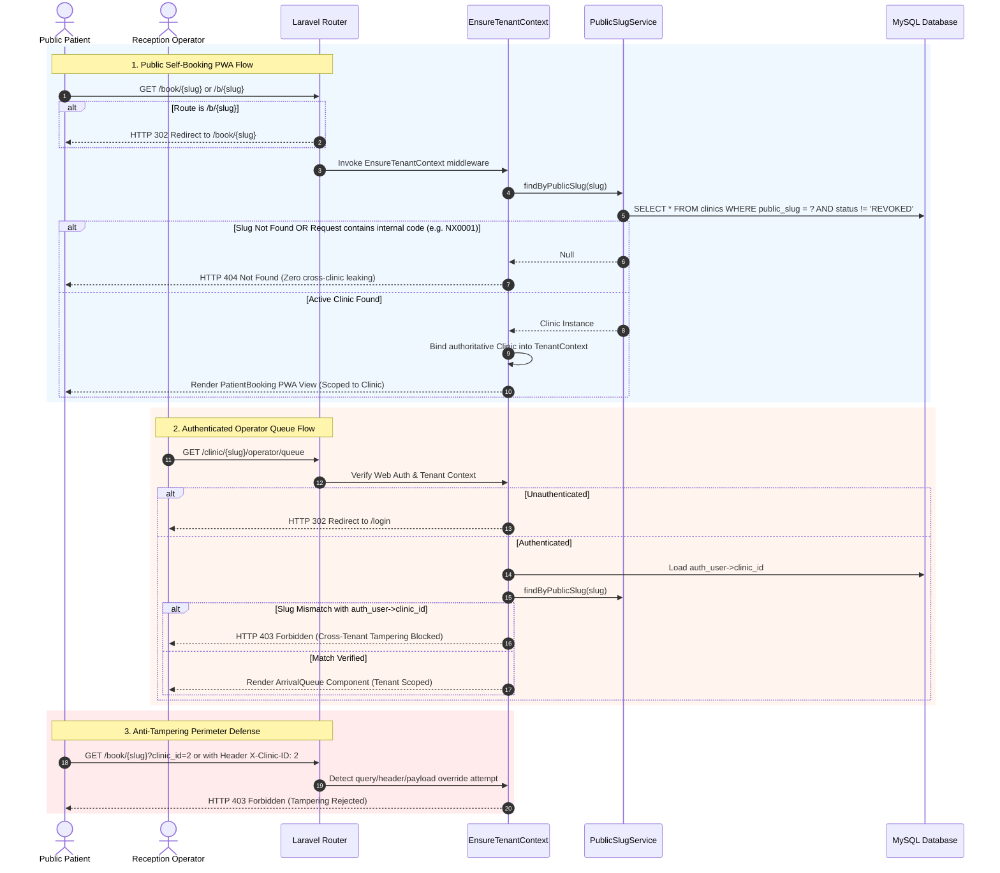


